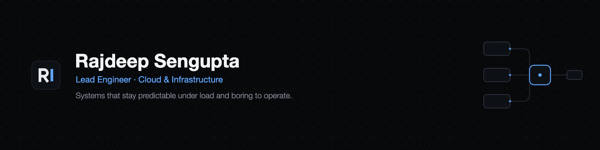

**Lead Engineer at [Chainrisk Labs](https://chainrisk.xyz).** I lead a team of five across a risk engine, a simulation pipeline, and the cloud platform underneath them.

Most of my work is deciding what a system actually has to guarantee, then removing everything that isn't that.

## Selected work

**Proof of Reserves over ~$1.5B in assets.** Attestations are computed inside AWS Nitro Enclaves, so execution is hardware-isolated and independently verifiable, then proven with zero-knowledge circuits written in Circom — reserves can be verified without exposing position-level data. Since extended to real-world assets (RWA).
→ [Write-up](https://rajdeepsengupta.com/blogs/3ba3f1da-77bc-80e0-a65d-ea039450f6d6)

**A risk engine that costs 60× less to run.** Rewrote Monte Carlo simulation in Rust with CUDA-accelerated kernels, replacing interpreted per-scenario execution with batched GPU compute: 60× lower cloud spend and 40× faster end to end. Parallelising Solidity test-case execution across cores took runs a further 16× faster.

**6M+ large-scale simulations a day.** Designed Chainrisk's cloud architecture from the ground up and owned it end to end — Docker, Kubernetes, Terraform and Ansible on AWS, every environment defined as code.

**A stack that costs 30× less to operate.** At DryFi, brought the software in-house on GCP and Firebase, taking monthly running cost from ₹30,000 to under ₹1,000.

## Open source

| Project | |
|---|---|
| [**flexauth**](https://github.com/Rajdip019/flexauth) | Flexible, blazingly fast, secure in-house auth you deploy on your own servers. `Rust` `Axum` `Tokio` `MongoDB` |
| [**freeflow**](https://github.com/Rajdip019/freeflow) | A CreativeOps tool for the design industry — manages the creative process from brief to delivery. `Next.js` `TypeScript` `GCP` `Firebase` |
| [**mamavault-backend-go**](https://github.com/Rajdip019/mamavault-backend-go) | Fully serverless backend for Prega, a document manager for expectant mothers. `Go` `Firebase` `Cloud Functions` |
| [**portfolio**](https://github.com/Rajdip019/portfolio) | My site — and a template anyone can fork. `Next.js` `TypeScript` `Notion as CMS` |

## Writing

I write about the parts of infrastructure that don't make good conference talks — at [rajdeepsengupta.com](https://rajdeepsengupta.com/blogs).

- [Proof of Reserves for $1.5B: attestation inside Nitro Enclaves, verified with Circom](https://rajdeepsengupta.com/blogs/3ba3f1da-77bc-80e0-a65d-ea039450f6d6)
- [Terraform Remote State Management with S3 and DynamoDB](https://rajdeepsengupta.com/blogs/2e93f1da-77bc-808a-8e68-e48a2d17e074)
- [Building a Production-Ready Retrieval-Augmented Generation (RAG) Application](https://rajdeepsengupta.com/blogs/1bf3f1da-77bc-8037-9e3a-d5c323a4b924)
- [Envelope Encryption: Securing User Data with Layered Protection](https://rajdeepsengupta.com/blogs/1a83f1da-77bc-80c9-9fe8-dcd13ae580f0)

## How I work

- Design the failure paths first — the happy path takes care of itself
- Cloud cost is a design constraint, not a monthly surprise
- Optimise CPU utilisation, not instance count
- Prefer simple systems that scale over clever ones that don't

## Stack

`Rust` `Go` `TypeScript` · `AWS` `GCP` · `Kubernetes` `Docker` `Terraform` `Ansible` `Linux` · `CUDA` `Circom` `Nitro Enclaves` · `PostgreSQL` `ClickHouse`

---

[Portfolio](https://rajdeepsengupta.com) · [LinkedIn](https://www.linkedin.com/in/rajdeep-sengupta/) · [X](https://x.com/RajdeepS019) · rajdipgupta019@gmail.com

Based in Kolkata, India (IST · UTC+5:30). Open to conversations about senior and lead infrastructure roles — remote, flexible across time zones.
